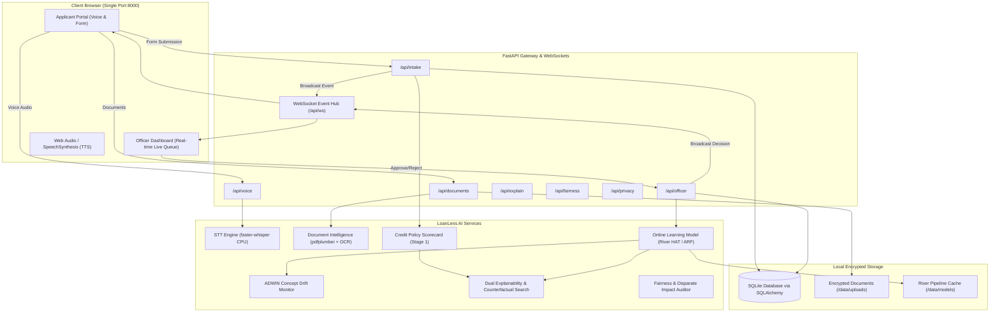
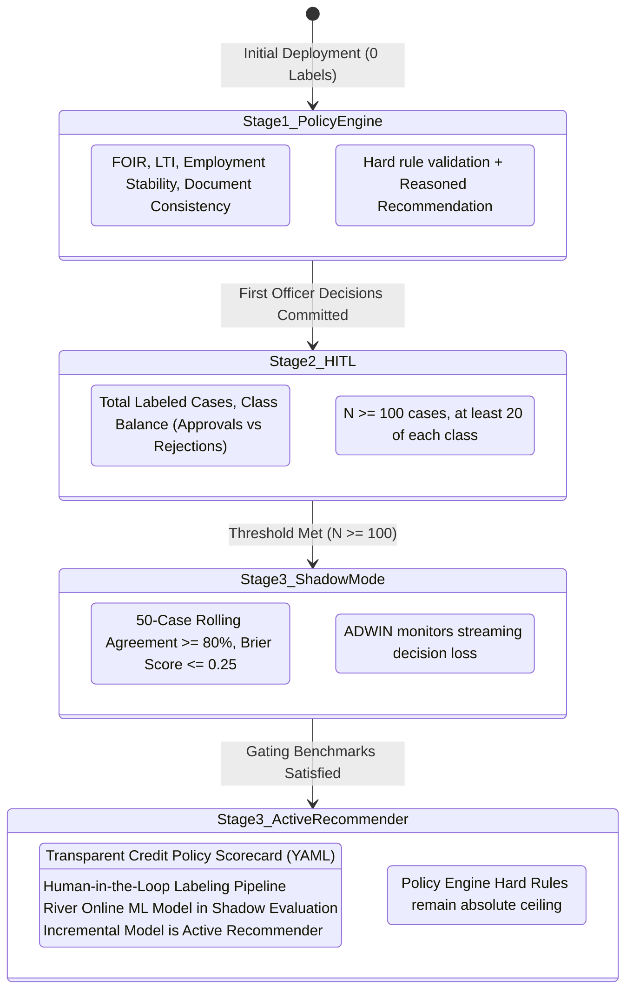
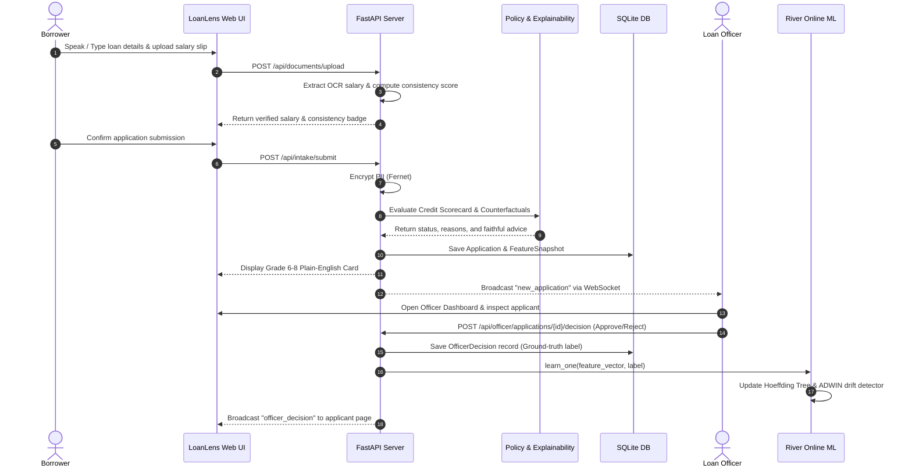
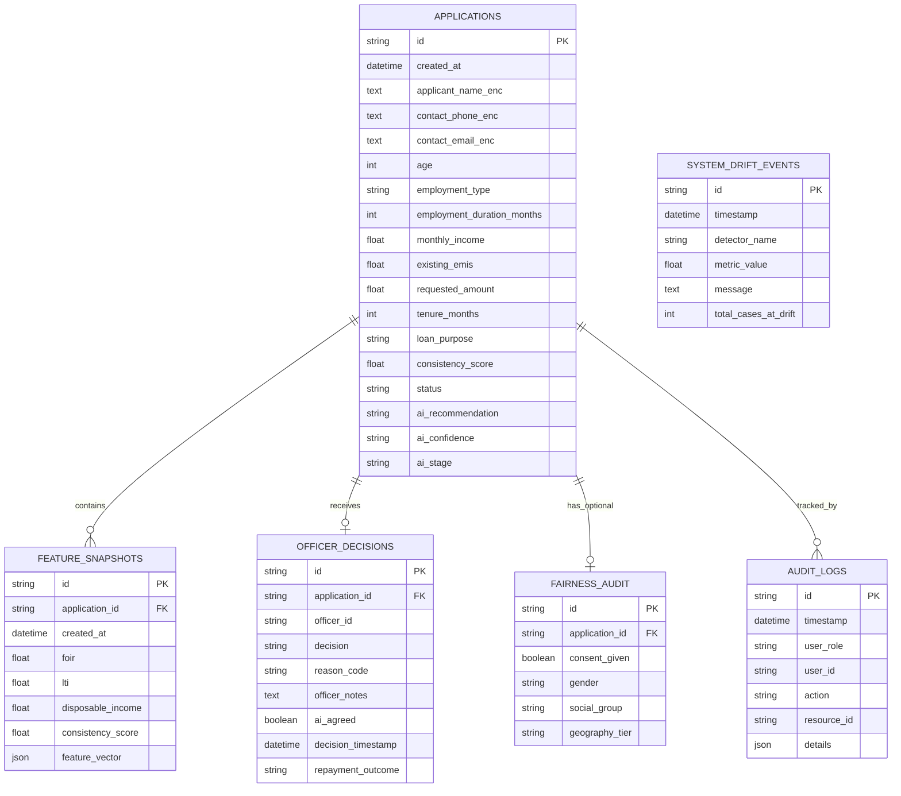

# LoanLens Architecture Specification
**End-to-End System Design & Data Pipelines**

---

## 1. System Overview & Component Architecture

LoanLens is structured as a decoupled, local-first web application where a single FastAPI backend serves both the REST API, WebSocket streams, and the compiled React frontend application.

---

## 2. Cold-Start Three-Stage Lifecycle

---

## 3. End-to-End Data Intake & Recommendation Flow

---

## 4. Database Entity-Relationship Architecture

